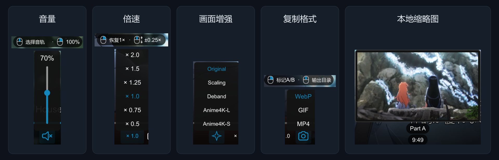
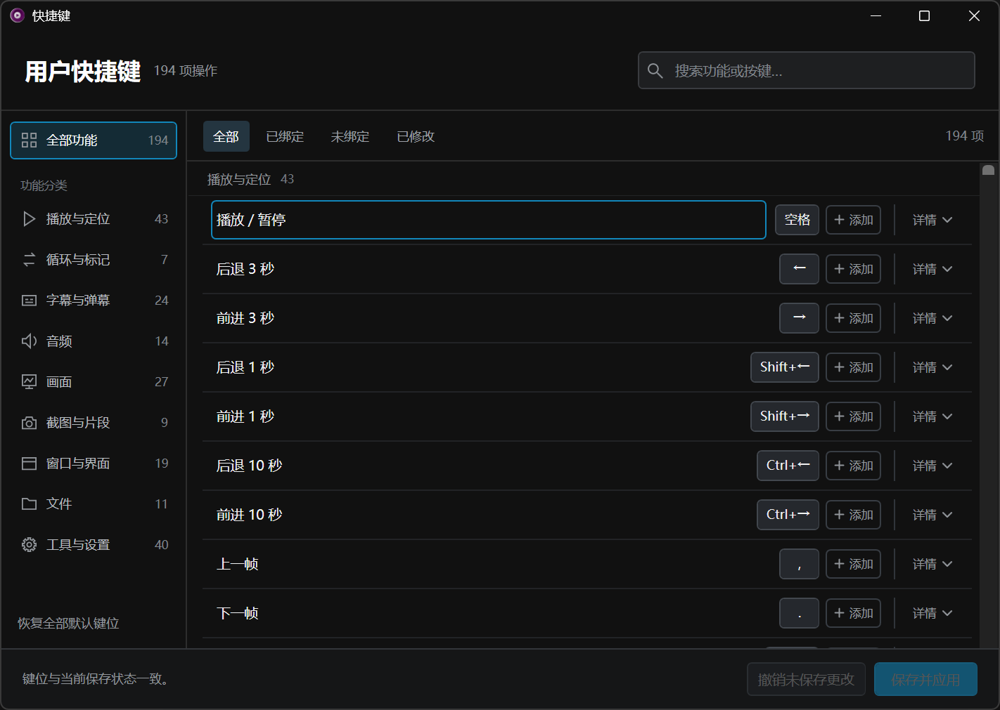

# Changelog

## 0.6.0

本版主要完善了播放列表功能、提供轻量的文件组织功能，并加入自动检查更新功能。

### 播放列表与文件组织

- 播放列表新增右键菜单，集中已有文件与队列操作。
- 通过打开/追加文件夹、剪贴板粘贴、播放列表直接拖入、播放列表右键等入口打开文件与文件夹，均支持音视频混排。
- 通过「打开文件夹」或「追加文件夹」加入媒体时，选择「包含子文件夹」，支持该目录下跨子目录将音视频文件自动加入列表。
- 支持载入 M3U／M3U8，保留列表中的顺序和重复项；并支持将当前队列保存为 M3U8。
- 常用设置新增「将图片纳入播放列表」选项，打开后能够支持图片查看功能；该功能默认关闭。
- 常用设置新增「启动时打开播放列表」选项。

### 自动检查更新

- 支持自动、手动检测 mpvnet-kit 的版本更新。同一新版只自动提示一次，无更新时保持静默。
- 当前版本的下载和安装仍需主动执行。该项目进一步完善后，将会考虑自动安装。

### 修复与优化

- 修复常用设置窗口部分文本显示不完整的问题。
- 修复常用设置窗口圆角失效的问题。
- 修复打开播放列表时可能会等待时间过长的问题。
- 播放列表的搜索框启用时，在外部点击，可以收起搜索框。

### 下载与更新

下载本页附件 `mpvnet-kit-0.6.0.zip`，完整解压到独立目录，退出播放器后运行 `Install.cmd`，选择自己的 `mpvnet.exe`。请使用完整附件，不要用 GitHub 自动生成的 Source code ZIP 安装。

## [0.5.0](https://github.com/takkoury/mpvnet-kit/releases/tag/v0.5.0)

本版更新以统一常用窗口、菜单和屏幕内列表的样式为主，并重写了 OSD 内容与逻辑。

### 界面与操作

- 统一播放列表、安装器、关于和媒体信息窗口。媒体信息可查看概览、完整详情并查找内容。
- 更新右键菜单和屏幕内选择列表；播放统计保留原有内容、分页与操作方式，调整显示样式。
- 日常设置和快捷键编辑集中到「工具与设置 > 常用设置…」，减少重复入口；已有个人键位和旧动作保持兼容；后续会对右键菜单进行进一步调整。
- 重写 OSD 内容与显示逻辑。

### 修复

- 修复打开设置中心等待时间可能过长的问题。
- 修复播放器已置顶时，设置窗口可能被播放器遮挡的问题。
- 修复播放列表打开时，右键菜单可能使列表错误移动和缩放的问题。
- 补齐无音轨、空列表、连接中与操作失败的提示，安装器优先显示中文失败原因。
- 加强安装相关路径检查。

### 下载与更新

下载本页附件 **mpvnet-kit-0.5.0.zip**，完整解压到独立目录，退出播放器后运行 `Install.cmd`，选择自己的 `mpvnet.exe`。请使用完整附件，不要用 GitHub 自动生成的 Source code ZIP 安装。

完整操作步骤见随包安装指南。

## [0.4.0](https://github.com/takkoury/mpvnet-kit/releases/tag/v0.4.0)

本版以常用设置中心为主要更新，另保留了原有播放功能和旧工具入口。

### 常用设置中心

- 新增「工具与设置 > 常用设置…」入口，作为更实用、更易看的设置中心，未来承接各项设置与配置项。
- 当前版本设置入口承接了：调整字幕、声音与音轨、窗口、控制栏、解码、输出路径和快捷键的设置。
- 支持全局搜索定位某项具体设置，支持分页保存、撤销、恢复。
- 字幕语言支持优先级、添加语言、快速排序，字幕字体支持从本机列表搜索、查看样张。支持效果实时预览。
- 控制栏设置支持快速调整控制栏大小，并提供窗口内实时预览。
- 快捷键设置内嵌进设置中心，保留独立搜索、分类与绑定状态筛选、双键录入、冲突提示及恢复；暂保留独立快捷键窗口。
- 其他各功能请直接使用感受。

本版暂不包含其他窗口、菜单、选择器与统计界面的进一步统一。

### 下载与安装

正式发布后，下载完整附件 `mpvnet-kit-0.4.0.zip`。不要使用 GitHub 自动生成的源码 ZIP 作为安装包。退出 mpv.net，解压完整包并运行 `Install.cmd`。从 0.3.0 升级无需清空配置。

## [0.3.0](https://github.com/takkoury/mpvnet-kit/releases/tag/v0.3.0)

本版更新如下：

**OSC 体验优化**：
- 底部功能区增加左键外的操作提示，方便查看各按钮的功能。
- 调整音量条和控制区的布局与交互。

**新增用户快捷键窗口**：
- 从右键菜单“工具与设置 → 用户快捷键”打开，界面与播放器整体风格保持一致。
- 整合 mpv 常用操作及本配置包提供的功能，共 9 类、194 项，每项最多可绑定两组快捷键。
- 支持分类、搜索、双键绑定、冲突检查和恢复默认。

**操作反馈优化**：
- 补充播放失败、截图、片段导出等场景的提示。

**安装器流程优化**：
- 支持首次安装、旧版更新和配置还原，无需预先清空配置目录。
- 更新前自动备份相关文件；遇到配置文件被修改等冲突时，保留现有文件并提示处理，本版不自动合并。
- 保留命令行维护方式，并支持恢复未完成的更新或还原操作。

## [0.2.0](https://github.com/takkoury/mpvnet-kit/releases/tag/v0.2.0)

本版主要改进特定场景下的体验：

- **窄窗、竖屏视频观看**：原方案下默认压缩底部功能栏导致丢失功能入口。目前采用两行空间 + 功能收纳的形式，保证任何大小的窗口下，均为全功能。
- **进度条加强**：A-B Loop、动态截取的 A-B 点，都会标注在进度条上，并对中间区域染色，暂停时也能及时更新。
- **字幕匹配**：字幕自动匹配放宽，自动搜索目录、子目录下的字幕。
- **右键菜单**：完全舍弃 mpv.net 的右键布局分类，按用途整理，保留原有低频入口。
- **Playlist**：可定位当前播放项，增强状态说明，融入原浮层。
- **片段截取**：逻辑重做，现在的截图浮层，选定格式后，直接决定后续片段截取格式，其他格式不落盘。

## [0.1.1](https://github.com/takkoury/mpvnet-kit/releases/tag/v0.1.1)

本次为维护修复版本。

#### 修复内容

- 修复弹幕过滤文件、正则组合及 HTTP 错误处理。
- 修复 Previous/Next 在队列边界的重载行为，以及 Speed 悬停后的滚轮调速。
- 改善 Playlist 与主窗可见边缘的贴合，保留焦点、宽度记忆和屏边覆盖布局。
- 修复章节预览中的特殊字符与超长标题显示。
- 为截取、队列和剪贴板 URL 拒绝补充明确的失败提示。

#### 下载与安装

下载 `mpvnet-kit-0.1.1.zip`，完整解压后运行 `Install.cmd`。`SHA256SUMS.txt` 提供安装包 SHA256 校验值。

已有配置的用户请先退出播放器并备份，按[安装指南](https://github.com/Takkoury/mpvnet-kit/blob/v0.1.1/docs/installation.md)处理旧配置后安装；图形安装器仅支持干净安装，不覆盖升级现有配置。

完整[功能指南](https://github.com/Takkoury/mpvnet-kit/blob/v0.1.1/docs/features.md)及[变更记录](https://github.com/Takkoury/mpvnet-kit/blob/v0.1.1/CHANGELOG.md)随包提供。播放器、FFmpeg 和 Python 由用户自行准备。

## [0.1.0](https://github.com/takkoury/mpvnet-kit/releases/tag/v0.1.0)

mpvnet-kit 首个正式版本：面向 Windows mpv.net 的界面与功能定制方案。

### 下载与安装

下载下方 **mpvnet-kit-0.1.0.zip**，完整解压后双击 `Install.cmd`，选择自己的 `mpvnet.exe`，等待检查通过并确认安装。

- 安装版和便携版均支持，配置目录自动识别。
- 已有配置请先自行备份并处理，安装器不会覆盖或合并。
- ZIP 包含完整配置、脚本、图形安装器、三份指南、界面演示和第三方许可；播放器、FFmpeg、Python 需自行准备。
- FFmpeg 用于片段导出，Python 用于弹幕转换；安装器仅检查 PATH，缺少它们仍可进行基本安装。
- 网页调起需要自行配置 External Player 和 URL Scheme Handler。

详细步骤见[安装指南](https://github.com/Takkoury/mpvnet-kit/blob/v0.1.0/docs/installation.md)。`SHA256SUMS.txt` 提供安装包的 SHA-256 校验值。

### 主要功能

- ModernZ 控制栏定制，窄悬停浮层、本地缩略图及清晰的按钮反馈。
- 独立 Playlist，支持搜索、拖动排序、追加与切换媒体。
- 整理播放、定位、音频和字幕快捷键，提供字幕位置、大小与延迟调整。
- 源 PNG 截图，以及 A/B 片段的 MP4、WebP、GIF 导出和文件剪贴板操作。
- Original、Scaling、Deband、Anime4K-L/S 五档画面预设，默认 Original，保持原帧率。
- 随包提供 Bilibili 兼容弹幕脚本及控制配置。

[功能与操作](https://github.com/Takkoury/mpvnet-kit/blob/v0.1.0/docs/features.md) · [配置说明](https://github.com/Takkoury/mpvnet-kit/blob/v0.1.0/docs/configuration.md)

### 兼容与限制

兼容基线为 mpv.net 7.1.2 / libmpv 0.41。网络缩略图默认关闭，Anime4K 仅用于符合条件的 SDR 素材；片段导出不烧入软字幕、弹幕和控制栏，也不无损保留 HDR 色彩链路。完整限制与后续方向见[README](https://github.com/Takkoury/mpvnet-kit/blob/v0.1.0/README.md#已知问题与限制)。

独立自有代码和文档采用 MIT，第三方组件及修改保留各自许可，详见[组件许可](https://github.com/Takkoury/mpvnet-kit/blob/v0.1.0/LICENSES.md)。
