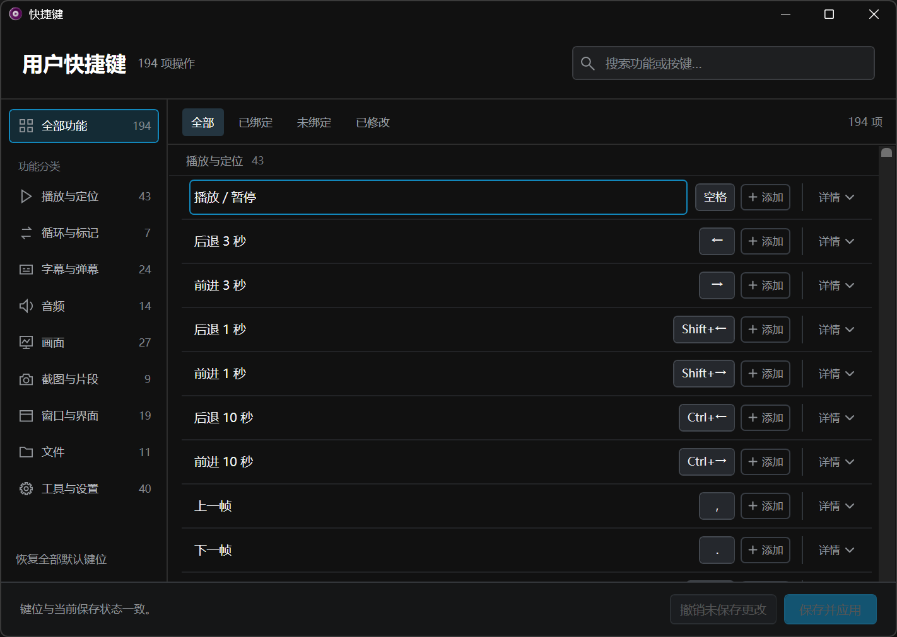

# mpvnet-kit

**mpvnet-kit 是一套面向 Windows mpv.net 的界面与功能定制方案。**

在 mpv.net 和 ModernZ 的基础上，调整控制栏与交互方式，开发独立播放列表、字幕调整、截图与片段导出等功能，并整理快捷键、操作反馈和画面增强预设。

当前版本：**0.3.0**。下载 [完整安装包](https://github.com/Takkoury/mpvnet-kit/releases/download/v0.3.0/mpvnet-kit-0.3.0.zip)，或查看 [Release 说明](https://github.com/Takkoury/mpvnet-kit/releases/tag/v0.3.0)。

当前验证基线为 mpv.net 7.1.2 / libmpv 0.41。版本变化见[变更记录](CHANGELOG.md)。

## 主要特性

- **集中的控制栏与清晰提示**：基于 ModernZ 整理控制栏布局、图标与提示，将速度、音量、画面增强和截图格式放入悬停浮层；配合自动隐藏、本地缩略图、章节与时间预览，让常用操作集中在视频周围。
- **鼠标操作与快捷键**：梳理播放、定位、字幕和音频操作，提供长按空格临时加速、分级跳转、逐帧、标记与循环；用简短文字和按钮状态反馈显示操作结果。
- **用户快捷键窗口**：从右键菜单“工具与设置 → 用户快捷键”打开，按 9 类浏览 194 项功能，每项最多绑定两组快捷键；支持搜索、冲突检查和恢复默认，个人键位独立保存。
- **安装、更新与还原**：图形安装器自动识别配置目录，更新前备份相关文件，并提供还原入口；遇到文件冲突时停止，不自动合并个人修改。
- **独立播放列表窗口**：播放列表以独立侧窗展示，跟随主窗口位置，支持搜索、拖动排序、追加文件和双击切换；可自动补充同目录的同类媒体，方便连续观看。
- **按需切换的画面增强**：默认 Original，可恢复当前媒体的原生渲染基准；提供配置好的 Scaling 缩放、Deband 去色带和 Anime4K-L/S 增强预设方案，保持原帧率。
- **常用观看工具**：
    - **截图分享**：支持源 PNG 截图，以及按起止时间导出 MP4、WebP 或 GIF；结果可复制到剪贴板，输出按媒体标题整理。
    - **字幕调整**：支持快速调整延迟、位置和大小；支持快速复制当前字幕文本、按字幕时间定位。
    - **网页调起兼容**：可配合用户自行配置的 [External Player](https://greasyfork.org/zh-CN/scripts/518677-external-player)、[URL Scheme Handler](https://github.com/LuckyPuppy514/url-scheme-handler)，从浏览器调用 mpv.net。
    - **Bilibili 弹幕接入**：随包提供基于 [MPV-Play-BiliBili-Comments](https://github.com/itKelis/MPV-Play-BiliBili-Comments) 的兼容脚本及控制配置，无需重复安装原版；准备 Python 后，可在弹幕数据可用时加载、显示与调整弹幕。

具体按钮、快捷键和使用条件见[功能与操作指南](docs/features.md)。

用户快捷键窗口

更多演示：播放列表、字幕调整与片段截取

右侧空间不足时，播放列表采用实际覆盖布局。

动图选取 3:00–8:00 的片段，展示 A、B 标记及导出时的区间染色；等待时间已压缩。

## 安装与更新

以下步骤适用于 [0.3.0 完整安装包](https://github.com/Takkoury/mpvnet-kit/releases/download/v0.3.0/mpvnet-kit-0.3.0.zip)。

1. 自行安装 [mpv.net](https://github.com/mpvnet-player/mpv.net/releases)。本包不包含播放器。
2. 将完整安装包解压到独立目录，不要解压到播放器的配置目录中。退出所有 mpv.net 实例。
3. 双击 `Install.cmd`，点击“浏览…”选择 `mpvnet.exe`。
4. 等待检查完成，核对配置目录、文件变更和备份位置，再点击“开始安装”或“开始更新”，确认后执行。
5. 完成后启动播放器，并保留备份目录。需要撤回时，再次打开安装器，选择“还原更新前配置”；首次安装对应“撤销本次安装”。

安装版和便携版均可使用。安装器依次检查已有的 `MPVNET_HOME`、播放器旁已有的 `portable_config`，否则使用当前用户 AppData 下的 `mpv.net`。操作前请核对窗口显示的完整目录。

**已有配置无需预先清空。** 安装器可识别完整匹配的 v0.1.0、v0.1.1 和 v0.2.0 配置，以及带有安装记录的配置。若配置包文件被修改、缺失或与新增文件重名，会停止并说明原因；请保留现场，按[安装指南](docs/installation.md)处理，不要为通过检查直接删除文件。

独立快捷键设置、本机路径配置及其他个人文件会保留。自动备份只涵盖本次操作涉及的文件，不是整个配置目录的完整副本。

### 可选功能准备

- [FFmpeg](https://www.ffmpeg.org/download.html)：用于片段导出。
- [Python](https://www.python.org/downloads/windows/)：用于弹幕转换。
- 网页视频调起：按 [External Player](https://greasyfork.org/zh-CN/scripts/518677-external-player) 和 [URL Scheme Handler](https://github.com/LuckyPuppy514/url-scheme-handler) 的说明配置，将播放器路径指向自己的 `mpvnet.exe`。

安装器仅从当前 PATH 查找 FFmpeg 和 Python，不执行或下载程序；缺少它们不影响基本安装。本机路径可按[配置说明](docs/configuration.md#3-本机路径与外部组件)单独设置。

## 文档导航

| 指南 | 内容 |
| --- | --- |
| [安装与个人配置维护](docs/installation.md) | 安装准备、更新与还原、冲突处理 |
| [功能与操作](docs/features.md) | **快捷键**、控制栏、字幕、Playlist、截图与增强 |
| [配置说明](docs/configuration.md) | 本机路径、外观、键位和个人参数 |

版本变化见[变更记录](CHANGELOG.md)。

## 未来计划
- 继续完善常用设置和窗口体验
- 统一所有区域和界面的视觉设计语言
- 继续评估增强播放的视听体验
- 增强弹幕相关功能
- 设计轻量内容文件组织方案
- 评估实现网络播放相关扩展

## 致谢与许可

感谢以下项目的作者、维护者与贡献者：

- [mpv](https://github.com/mpv-player/mpv) / [mpv.net](https://github.com/mpvnet-player/mpv.net)：播放核心与 Windows 播放器。
- [ModernZ](https://github.com/Samillion/ModernZ)：控制栏及界面定制的基础。
- [thumbfast](https://github.com/po5/thumbfast)：进度条缩略图预览。
- [Anime4K](https://github.com/bloc97/Anime4K)：画面增强所用的 shader。
- [MPV-Play-BiliBili-Comments](https://github.com/itKelis/MPV-Play-BiliBili-Comments)：弹幕加载与转换组件的来源。
- [Google Material Symbols](https://github.com/google/material-design-icons) / [Microsoft Fluent System Icons](https://github.com/microsoft/fluentui-system-icons)：随 ModernZ 图标字体提供的图标来源。

可选功能还使用 [External Player](https://greasyfork.org/zh-CN/scripts/518677-external-player)、[URL Scheme Handler](https://github.com/LuckyPuppy514/url-scheme-handler)、[FFmpeg](https://www.ffmpeg.org/) 和 [Python](https://www.python.org/)，这些外部组件由用户自行准备。

独立自有代码、配置和文档采用 [MIT](LICENSE)；第三方组件及其派生修改分别遵循各自许可。完整来源、归属和许可范围见[组件许可](LICENSES.md)。
