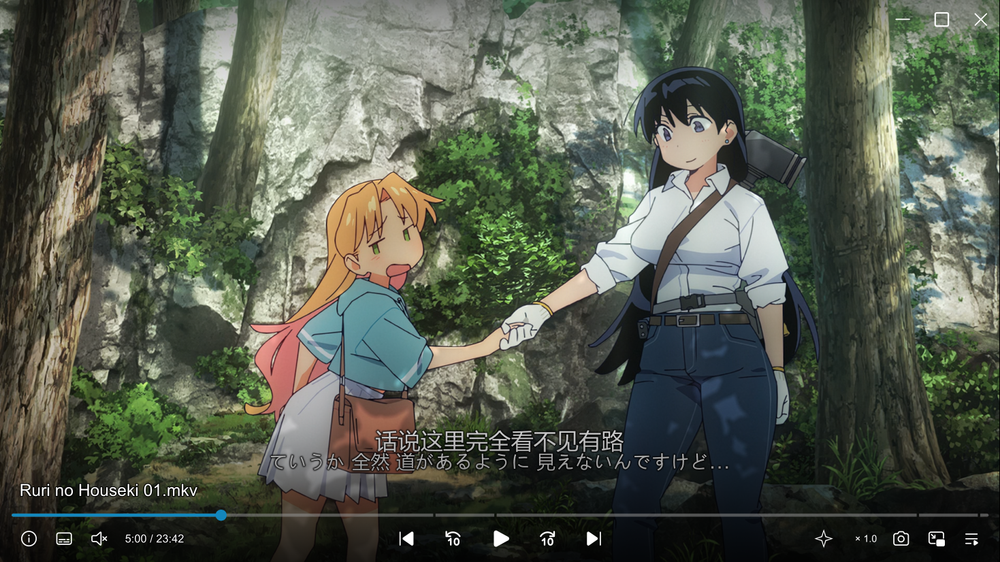
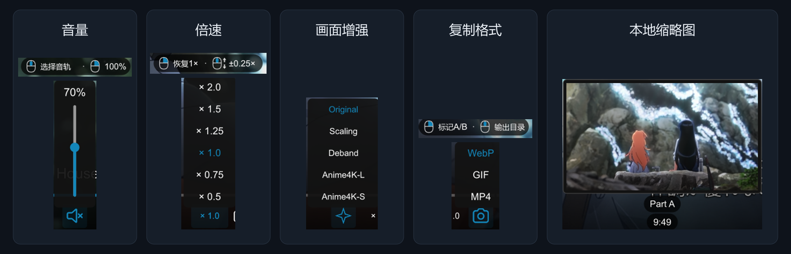
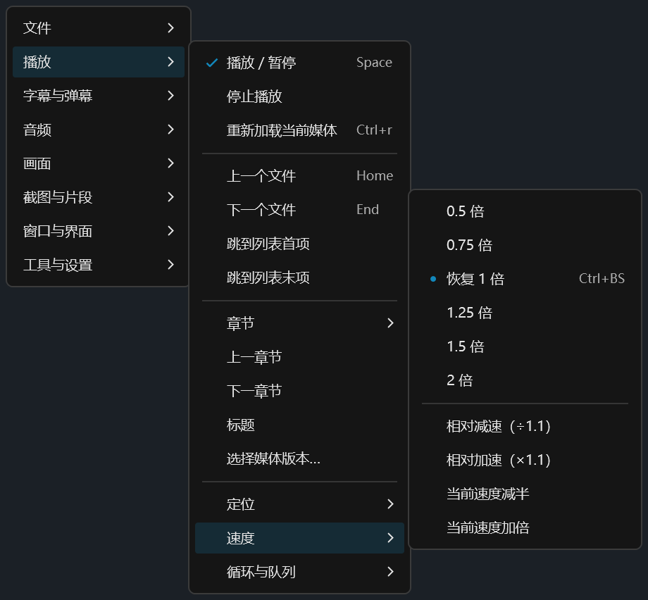
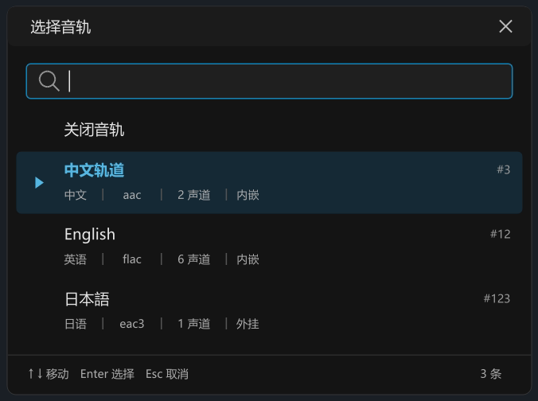
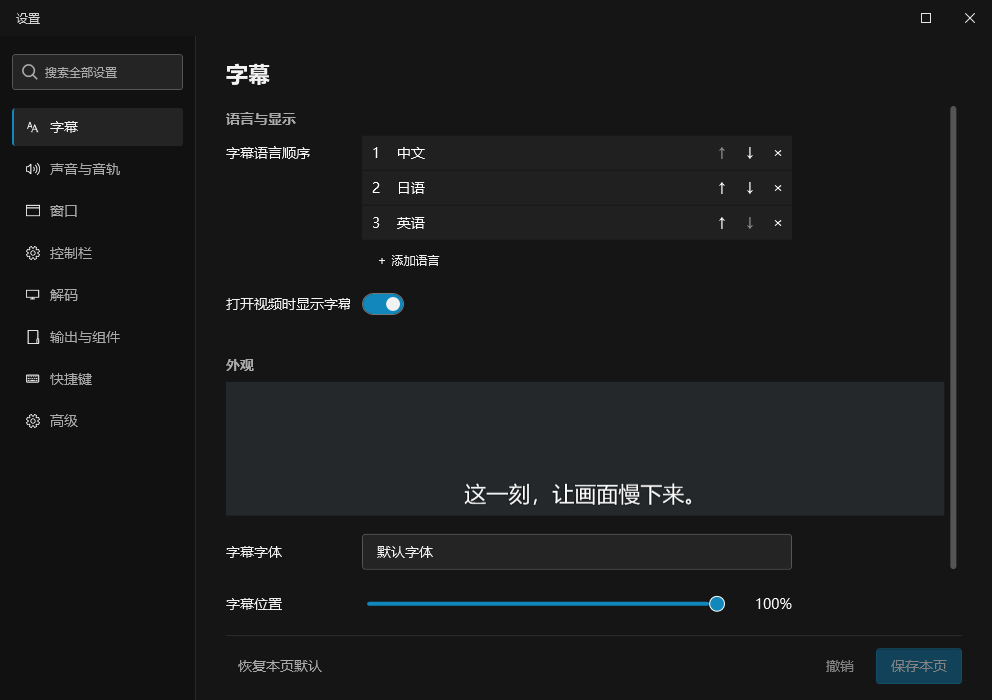
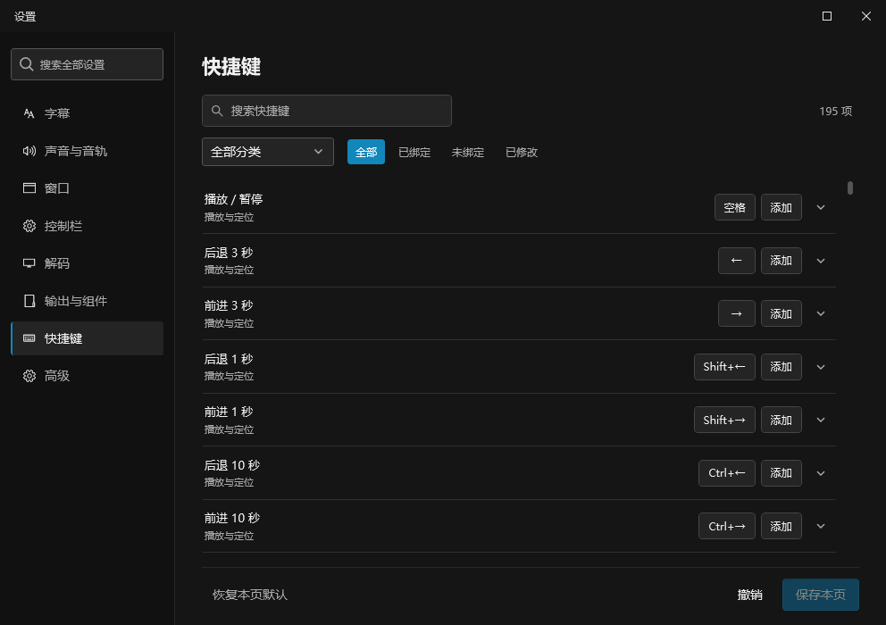
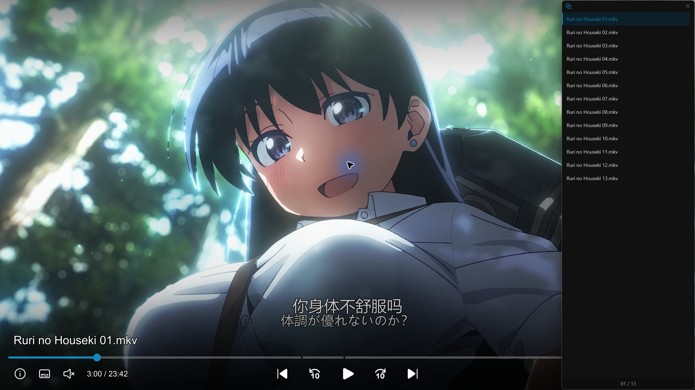
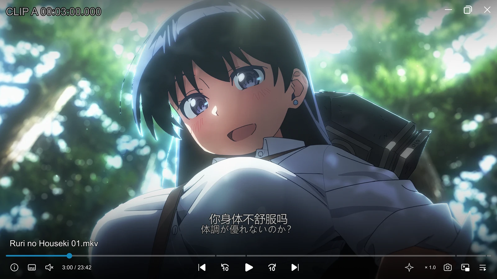

# mpvnet-kit

**一套基于 mpv.net 的界面与功能定制方案。追求播放质量，以及播放器本身好用、实用、易用。**

基于 mpv.net 和 ModernZ，对大量操作逻辑与反馈重新设计，开发大量实用功能。

当前公开版本为 **0.7.0**，见 [Releases](https://github.com/takkoury/mpvnet-kit/releases)。

当前验证的基线为 mpv.net 7.1.2 / libmpv 0.41。版本变化见[变更记录](CHANGELOG.md)。

## 主要特性

- **好用、实用、易用的控制栏设计**：基于 ModernZ 整理控制栏布局、图标与提示，将速度、音量、画面增强和截图格式放入悬停浮层；配合自动隐藏、本地缩略图、章节与时间预览，让常用操作集中在视频周围。
- **重做操作反馈体系，更符合逻辑**：梳理播放、定位、字幕和音频操作，提供长按空格临时加速、分级跳转、逐帧、标记与循环；用简短文字和按钮状态反馈显示操作结果。
- **更好用的快捷键编辑**：在常用设置的快捷键页，按 9 类浏览 199 项功能，每项最多绑定两组按键；支持独立搜索、冲突提示和恢复默认。个人键位独立保存。
- **快速切换画面增强方案**：默认 Original，可恢复当前媒体的原生渲染基准；提供配置好的 Scaling 缩放、Deband 去色带和 Anime4K-L/S 增强预设方案，保持原帧率。
- **各种特色实用功能**：
    - **快速截取分享**：支持源 PNG 截图，以及按起止时间导出 MP4、WebP 或 GIF；结果可复制到剪贴板，输出按媒体标题整理。
    - **字幕调整模式**：支持快速调整延迟、位置和大小；支持快速复制当前字幕文本、按字幕时间定位。
    - **兼容网页调起**：可配合用户自行配置的 [External Player](https://greasyfork.org/zh-CN/scripts/518677-external-player)、[URL Scheme Handler](https://github.com/LuckyPuppy514/url-scheme-handler)，从浏览器调用 mpv.net。
    - **Bilibili 弹幕接入**：随包提供基于 [MPV-Play-BiliBili-Comments](https://github.com/itKelis/MPV-Play-BiliBili-Comments) 的兼容脚本及控制配置，无需重复安装原版；准备 Python 后，可在弹幕数据可用时加载、显示与调整弹幕。
- **独立播放列表窗口**：播放列表以独立侧窗展示，跟随主窗口位置，支持搜索、拖动排序、追加文件和双击切换；右键菜单集中常用文件与队列操作。可自动补充同目录的同类媒体，也可设置启动时打开侧窗。
- **轻量文件组织**：支持音视频混排，打开或追加文件夹时可选择包含子文件夹；可载入 M3U／M3U8，也可将当前列表保存为 M3U8。图片可通过默认关闭的选项纳入列表。
- **常用设置集中管理**：从右键「工具与设置 → 常用设置…」调整字幕、声音、窗口、控制栏、解码、输出路径和快捷键。支持跨分类搜索、按页草稿、保存、撤销和恢复默认。
- **统一的界面与中文提示**：播放列表、安装器、媒体信息、右键菜单和屏幕内选择列表采用统一样式；常用设置提前在后台准备，减少打开等待。
- **字幕与控制栏预览**：字幕语言用列表排序，字体可搜索并查看示例，位置和缩放通过滑块调整；控制栏在设置窗口内实时预览，无需回到视频窗口手动呼出。
- **安装、更新与还原**：图形安装器自动识别配置目录，更新前备份相关文件，并提供还原入口；遇到文件冲突时停止，不自动合并个人修改。

具体按钮、快捷键和使用条件见[功能与操作指南](docs/features.md)。

<strong>OSC 控制栏</strong>

<strong>右键菜单</strong>

<strong>屏幕内选择器</strong>

<strong>常用设置</strong>

字幕示例不依赖当前视频是否有字幕；实际字幕效果仍取决于字幕格式和自带样式。关闭时可保存所有未保存分类、不保存或取消。

<strong>快捷键设置</strong>

<strong>更多演示：播放列表、字幕调整与片段截取</strong>

右侧空间不足时，播放列表采用实际覆盖布局。

动图选取 3:00–8:00 的片段，展示 A、B 标记及导出时的区间染色；等待时间已压缩。

## 安装与更新

从 [Releases](https://github.com/takkoury/mpvnet-kit/releases) 下载 Windows x64 离线安装程序 `mpvnet-kit-0.7.0.exe`。它随附 mpv.net 官方原版 7.1.2.0 portable 和同一份 mpvnet-kit。退出播放器，双击 EXE 打开安装窗口。

- **已有 mpv.net**　核对窗口识别的播放器，或点「已有…」选择平时使用的 `mpvnet.exe`。安装器检查播放器与播放核心是否兼容，显示实际配置目录。确认后安装或更新套件，保留个人配置，更新前自动备份。
- **首次安装**　点「新装…」选择空文件夹。安装器校验随包的官方播放器并安装套件。完成后双击所选目录的 `Play.cmd` 启动。
- **还原配置**　再次运行同一 EXE，选择已安装的播放器，按窗口提示撤销安装或还原最近一次更新。

详细步骤和冲突处理见[安装指南](docs/installation.md)。

### 特色功能推荐组件

- [FFmpeg](https://www.ffmpeg.org/download.html)：用于片段导出。
- [Python](https://www.python.org/downloads/windows/)：用于弹幕转换。
- 网页视频调起：按 [External Player](https://greasyfork.org/zh-CN/scripts/518677-external-player) 和 [URL Scheme Handler](https://github.com/LuckyPuppy514/url-scheme-handler) 的说明配置，将播放器路径指向自己的 `mpvnet.exe`。

## 文档导航

| 指南 | 内容 |
| --- | --- |
| [安装与个人配置维护](docs/installation.md) | 安装准备、更新与还原、冲突处理 |
| [功能与操作](docs/features.md) | **快捷键**、控制栏、字幕、Playlist、截图与增强 |
| [配置说明](docs/configuration.md) | 本机路径、外观、键位和个人参数 |

版本变化见[变更记录](CHANGELOG.md)。

## 本项目 Roadmap
- [x] **观看与操作体验**：基于 `mpv.net`，忠于片源，还原片源原本的色彩与质量；设计全新的鼠标、键盘快捷键逻辑，定制各种实用操作
- [x] **构建好用好看的控制栏**：基于 `ModernZ`，优化视觉设计，完全重做功能布局、操作逻辑、提示反馈
- [x] **配置安全安装/升级恢复**：图形安装器自动识别配置目录，更新前备份相关文件，并提供还原入口
- [x] **统一界面与常用设置**：对 OSC、右键菜单、设置中心、所有选择器等各类 mpv 界面进行统一
- [x] **轻量内容文件组织**：文件夹与可选递归入队、音视频混排、轻度图片管理、播放列表文件读写
- [x] **自动检查更新**：自动或手动检查正式版本，提示后由用户下载和安装
- [x] **完整播放器发行包**：一个离线安装程序支持已有播放器更新和新装
- [ ] （学习中，暂缓）评估视听体验的增强方案
- [ ] 网络播放相关扩展 👈 进行中
- [ ] 增强弹幕相关功能
- [ ] 统一所有区域和界面的视觉设计语言
- [ ] 丰富播放器可配置性、多语言支持、更多外观美化……

## 致谢与许可

感谢以下项目的作者、维护者与贡献者：

- [mpv](https://github.com/mpv-player/mpv) / [mpv.net](https://github.com/mpvnet-player/mpv.net)：播放核心与 Windows 播放器。
- [ModernZ](https://github.com/Samillion/ModernZ)：控制栏及界面定制的基础。
- [thumbfast](https://github.com/po5/thumbfast)：进度条缩略图预览。
- [Anime4K](https://github.com/bloc97/Anime4K)：画面增强所用的 shader。
- [MPV-Play-BiliBili-Comments](https://github.com/itKelis/MPV-Play-BiliBili-Comments)：弹幕加载与转换组件的来源。

可选功能还使用 [External Player](https://greasyfork.org/zh-CN/scripts/518677-external-player)、[URL Scheme Handler](https://github.com/LuckyPuppy514/url-scheme-handler)、[FFmpeg](https://www.ffmpeg.org/) 和 [Python](https://www.python.org/)，这些外部组件由用户自行准备。

独立自有代码、配置和文档采用 [MIT](LICENSE)；第三方组件及其派生修改分别遵循各自许可。完整来源、归属和许可范围见[组件许可](LICENSES.md)。
