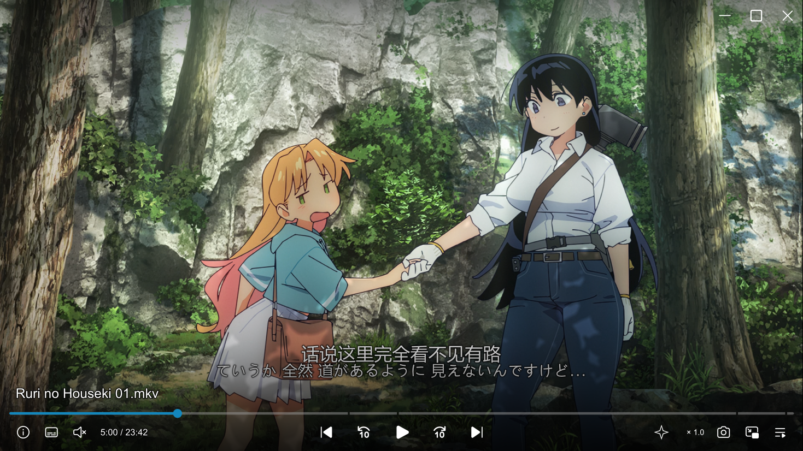
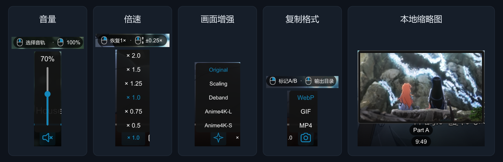
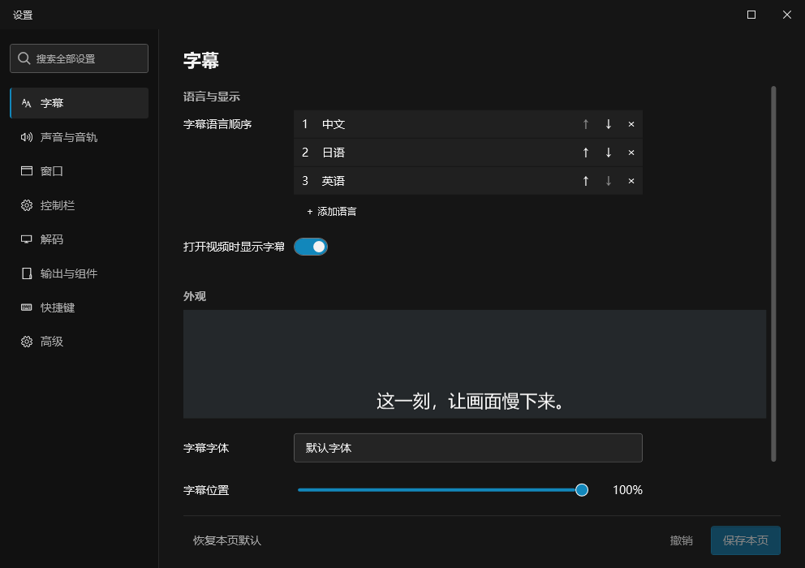
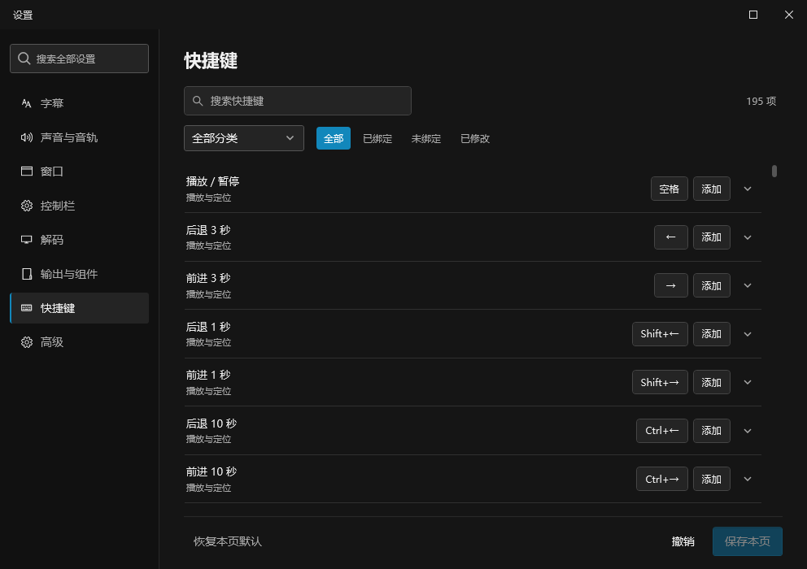
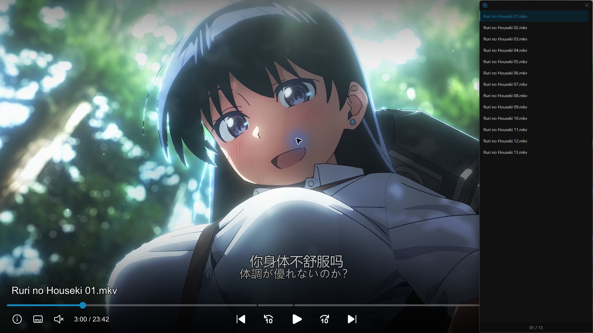
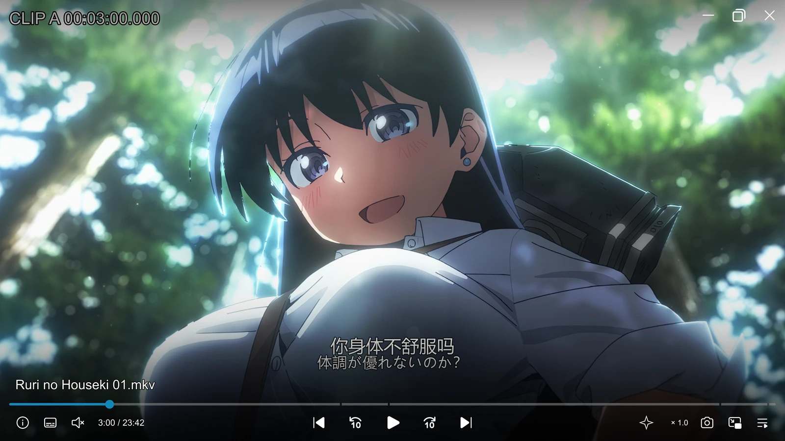

# mpvnet-kit

**一套基于 mpv.net 的界面与功能定制方案。追求播放质量，以及播放器本身好用、实用、易用。**

基于 mpv.net 和 ModernZ，对大量操作逻辑与反馈重新设计，开发大量实用功能。

当前版本：**0.4.0**。下载[完整安装包](https://github.com/Takkoury/mpvnet-kit/releases/download/v0.4.0/mpvnet-kit-0.4.0.zip)，或查看 [Release 说明](https://github.com/Takkoury/mpvnet-kit/releases/tag/v0.4.0)。

当前验证的基线为 mpv.net 7.1.2 / libmpv 0.41。版本变化见[变更记录](CHANGELOG.md)。

## 主要特性

- **好用、实用、易用的控制栏设计**：基于 ModernZ 整理控制栏布局、图标与提示，将速度、音量、画面增强和截图格式放入悬停浮层；配合自动隐藏、本地缩略图、章节与时间预览，让常用操作集中在视频周围。
- **重做操作反馈体系，更符合逻辑**：梳理播放、定位、字幕和音频操作，提供长按空格临时加速、分级跳转、逐帧、标记与循环；用简短文字和按钮状态反馈显示操作结果。
- **更好用的快捷键编辑**：在常用设置的快捷键页，按 9 类浏览 195 项功能，每项最多绑定两组按键；支持独立搜索、冲突提示和恢复默认。个人键位独立保存，原「用户快捷键」窗口入口仍保留。
- **快速切换画面增强方案**：默认 Original，可恢复当前媒体的原生渲染基准；提供配置好的 Scaling 缩放、Deband 去色带和 Anime4K-L/S 增强预设方案，保持原帧率。
- **各种特色实用功能**：
    - **截图分享**：支持源 PNG 截图，以及按起止时间导出 MP4、WebP 或 GIF；结果可复制到剪贴板，输出按媒体标题整理。
    - **字幕调整**：支持快速调整延迟、位置和大小；支持快速复制当前字幕文本、按字幕时间定位。
    - **网页调起兼容**：可配合用户自行配置的 [External Player](https://greasyfork.org/zh-CN/scripts/518677-external-player)、[URL Scheme Handler](https://github.com/LuckyPuppy514/url-scheme-handler)，从浏览器调用 mpv.net。
    - **Bilibili 弹幕接入**：随包提供基于 [MPV-Play-BiliBili-Comments](https://github.com/itKelis/MPV-Play-BiliBili-Comments) 的兼容脚本及控制配置，无需重复安装原版；准备 Python 后，可在弹幕数据可用时加载、显示与调整弹幕。
- **独立播放列表窗口**：播放列表以独立侧窗展示，跟随主窗口位置，支持搜索、拖动排序、追加文件和双击切换；可自动补充同目录的同类媒体，方便连续观看。
- **常用设置集中管理**：从右键「工具与设置 → 常用设置…」调整字幕、声音、窗口、控制栏、解码、输出路径和快捷键。支持跨分类搜索、按页草稿、保存、撤销和恢复默认。
- **字幕与控制栏预览**：字幕语言用列表排序，字体可搜索并查看示例，位置和缩放通过滑块调整；控制栏在设置窗口内实时预览，无需回到视频窗口手动呼出。
- **安装、更新与还原**：图形安装器自动识别配置目录，更新前备份相关文件，并提供还原入口；遇到文件冲突时停止，不自动合并个人修改。

具体按钮、快捷键和使用条件见[功能与操作指南](docs/features.md)。

常用设置

字幕示例不依赖当前视频是否有字幕；实际字幕效果仍取决于字幕格式和自带样式。关闭时可保存所有未保存分类、不保存或取消。

快捷键设置

更多演示：播放列表、字幕调整与片段截取

右侧空间不足时，播放列表采用实际覆盖布局。

动图选取 3:00–8:00 的片段，展示 A、B 标记及导出时的区间染色；等待时间已压缩。

## 安装与更新

使用 [0.4.0 完整发行 ZIP](https://github.com/Takkoury/mpvnet-kit/releases/download/v0.4.0/mpvnet-kit-0.4.0.zip) 安装，具体步骤见[安装指南](docs/installation.md)；请使用与安装包对应的随包指南。

1. 自行安装 [mpv.net](https://github.com/mpvnet-player/mpv.net/releases)。本包不包含播放器，未来会将 mpv.net 集成到同一个包里。
2. 退出 mpv.net。将完整安装包解压到**独立**目录。
3. 打开 `Install.cmd`，点击「浏览…」，找到并选择本机的 `mpvnet.exe`。
4. 等待检查完成，核对配置目录、文件变更和备份位置，再点击「开始安装」或「开始更新」。
5. 完成后启动播放器，并保留备份目录。
6. 需要撤回时，再次打开安装器，选择「还原更新前配置」。

`mpv.net` 的安装版和便携版均可使用。安装器会依次检查已有的 `MPVNET_HOME`、播放器旁已有的 `portable_config`，否则使用当前用户 AppData 下的 `mpv.net`。

**已有配置无需预先清空。** 安装器可识别完整匹配的 v0.1.0、v0.1.1 和 v0.2.0 配置，以及带有安装记录的配置。若配置包文件被修改、缺失或与新增文件重名，会停止并说明原因；请保留现场，按[安装指南](docs/installation.md)处理，不要为通过检查直接删除文件。

独立保存的常用设置、快捷键、本机路径及其他个人文件会保留。自动备份只涵盖本次操作涉及的文件，不是整个配置目录的完整副本。

从 0.3.0 升级到 0.4.0 时，未另行配置的普通字幕会按中文、日语、英语的顺序选择，并默认显示；音轨不指定优先语言。已有个人覆盖保持。若直接改过配置包中的文件，安装器会停止并提示冲突，不会自动合并或强行覆盖。升级前请阅读[更新提示](docs/upgrade-notice.txt)。

### 可选功能准备

- [FFmpeg](https://www.ffmpeg.org/download.html)：用于片段导出。
- [Python](https://www.python.org/downloads/windows/)：用于弹幕转换。
- 网页视频调起：按 [External Player](https://greasyfork.org/zh-CN/scripts/518677-external-player) 和 [URL Scheme Handler](https://github.com/LuckyPuppy514/url-scheme-handler) 的说明配置，将播放器路径指向自己的 `mpvnet.exe`。

安装器仅从当前 PATH 查找 FFmpeg 和 Python，不执行或下载程序；缺少它们不影响基本安装。本机路径可按[配置说明](docs/configuration.md#3-本机路径与外部组件)单独设置。

## 文档导航

| 指南 | 内容 |
| --- | --- |
| [安装与个人配置维护](docs/installation.md) | 安装准备、更新与还原、冲突处理 |
| [功能与操作](docs/features.md) | **快捷键**、控制栏、字幕、Playlist、截图与增强 |
| [配置说明](docs/configuration.md) | 本机路径、外观、键位和个人参数 |

版本变化见[变更记录](CHANGELOG.md)。

## 本项目 Roadmap
- [x] **观看与操作体验**：基于 `mpv.net`，忠于片源，还原片源原本的色彩与质量；设计全新的鼠标、键盘快捷键逻辑，定制各种实用操作
- [x] **构建好用好看的控制栏**：基于 `ModernZ`，优化视觉设计，完全重做功能布局、操作逻辑、提示反馈
- [x] **配置安全安装/升级恢复**：图形安装器自动识别配置目录，更新前备份相关文件，并提供还原入口
- [ ] **统一界面与常用设置**👈 进行中
- [ ] 设计轻量内容文件组织方案
- [ ] 完整播放器发行包
- [ ] 评估视听体验的增强方案
- [ ] 网络播放相关扩展
- [ ] 增强弹幕相关功能
- [ ] 统一所有区域和界面的视觉设计语言
- [ ] 丰富播放器可配置性、多语言支持、更多外观美化……

## 致谢与许可

感谢以下项目的作者、维护者与贡献者：

- [mpv](https://github.com/mpv-player/mpv) / [mpv.net](https://github.com/mpvnet-player/mpv.net)：播放核心与 Windows 播放器。
- [ModernZ](https://github.com/Samillion/ModernZ)：控制栏及界面定制的基础。
- [thumbfast](https://github.com/po5/thumbfast)：进度条缩略图预览。
- [Anime4K](https://github.com/bloc97/Anime4K)：画面增强所用的 shader。
- [MPV-Play-BiliBili-Comments](https://github.com/itKelis/MPV-Play-BiliBili-Comments)：弹幕加载与转换组件的来源。
- [Google Material Symbols](https://github.com/google/material-design-icons) / [Microsoft Fluent System Icons](https://github.com/microsoft/fluentui-system-icons)：随 ModernZ 图标字体提供的图标来源。

可选功能还使用 [External Player](https://greasyfork.org/zh-CN/scripts/518677-external-player)、[URL Scheme Handler](https://github.com/LuckyPuppy514/url-scheme-handler)、[FFmpeg](https://www.ffmpeg.org/) 和 [Python](https://www.python.org/)，这些外部组件由用户自行准备。

独立自有代码、配置和文档采用 [MIT](LICENSE)；第三方组件及其派生修改分别遵循各自许可。完整来源、归属和许可范围见[组件许可](LICENSES.md)。
